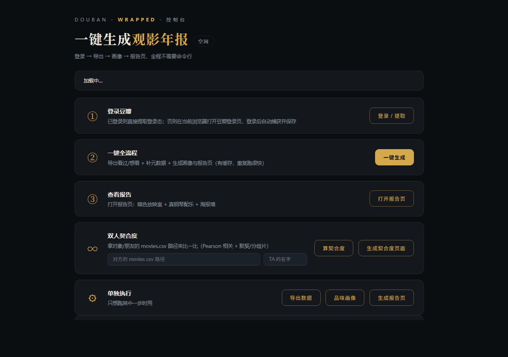
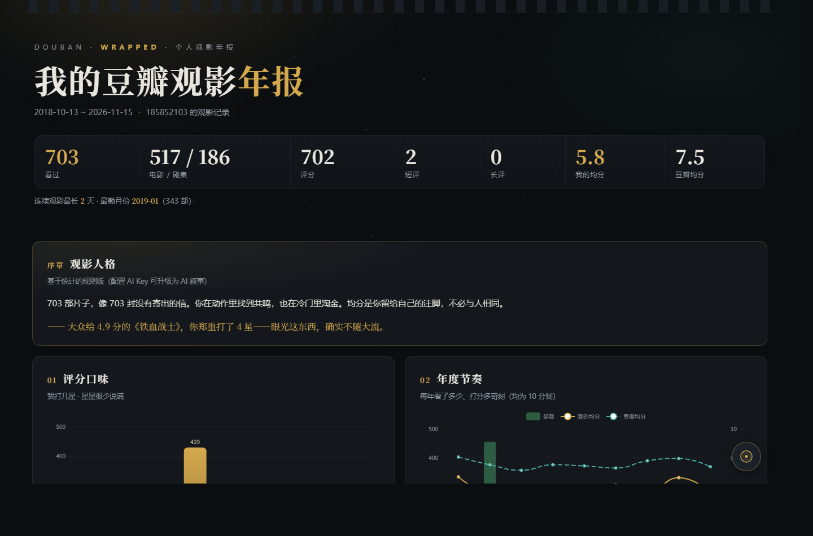
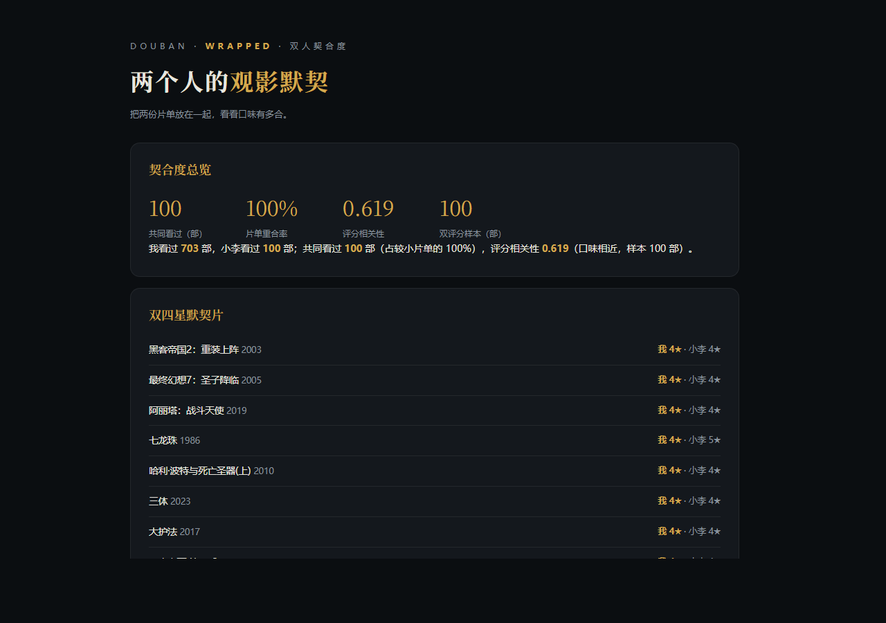

# douban-wrapped · 豆瓣观影品味画像 + 年度报告

把「我的豆瓣电影」变成一份可分享的年度观影报告：品味象限、观影日历、
常客导演/演员、海报墙、观影人格——全程不用命令行也能跑。

> 对标 Spotify Wrapped，但数据是你自己一星一星 mark 出来的。
> 当前版本 **v0.2.0**。

## 截图预览

| 控制台 | 报告页（概览） | 双人契合度 |
| :---: | :---: | :---: |
|  |  |  |

## 功能一览

- **傻瓜式控制台**：双击 `启动控制台.bat` → 当前浏览器打开本地控制台 →
  点「登录 / 提取」（已登录直接提取登录态）→ 点「一键生成」→ 点「打开报告页」；
  任务运行中可「中止运行」，支持单步执行与报告页预览
- **程序内登录**：已登录则直接提取；未登录时在当前浏览器打开豆瓣登录页，
  登录后自动捕获并保存 Cookie（Edge 优先，兼容 Chrome/Cent/Firefox）
- **数据导出**：批量 interests 接口（~20 次请求拿全量 900+ 条含元数据，失败自动回退列表抓取），
  支持 `--incremental` 增量同步；批量接口漏掉的记录自动从旧 JSONL 找回
- **品味画像**（17 个章节）：
  评分口味 / 年度节奏（含年度之最）/ 品味象限气泡图 / 观影日历（可选年份）/
  类型偏好 / 观影地图 / 年代考古 / 电影 vs 剧集 / 常客导演 / 常客演员 /
  年度十佳 / 我的遗珠 / 冷门佳片 / 异见时刻 / 短评高频词 / 品味标签 / 想看方向
- **年度报告页**：单文件 HTML（ECharts 内联，离线可开），暗色放映室主题、
  真钢琴 BGM（自动渐入循环）、随音乐呼吸的尘埃特效、仙女棒光标、宽屏自适应；
  海报自动缓存到本地并带防盗链代理与文字占位符兜底
- **观影人格**：多组文艺模板按数据拆分组合（512+ 种），每次生成都不同
- **双人契合度**：两份片单求交集 + 评分 Pearson 相关，**独立页面**展示
- **Letterboxd 迁移**：看过记录一键导出兼容 CSV

## 快速开始

零第三方依赖，Python 3.10+，Windows 优先（Edge 自带，开箱即用）。

```bash
# 方式一：pip 安装
pip install git+https://github.com/douban-wrapped/douban-wrapped.git

# 方式二：克隆即用
git clone https://github.com/douban-wrapped/douban-wrapped.git && cd douban-wrapped
```

**傻瓜式（推荐）**：双击 `启动控制台.bat` → 浏览器自动打开控制台 →
点「登录 / 提取」→ 点「一键生成」→ 点「打开报告页」。完事。

**命令行**：

```bash
python -m douban_wrapped all --open     # 全流程：登录→导出→画像→报告→自动打开
# 或分步：
python -m douban_wrapped login          # 当前浏览器打开登录页，已登录则直接提取
python -m douban_wrapped export         # 导出 + 元数据补全 → data/movies.csv
python -m douban_wrapped analyze        # 品味画像 → data/profile.json
python -m douban_wrapped report         # 报告页 → output/report.html
```

其他命令：

```bash
python -m douban_wrapped export --incremental   # 增量同步
python -m douban_wrapped export --no-fast       # 强制走列表抓取
python -m douban_wrapped enrich                 # 只补元数据（缓存续跑）
python -m douban_wrapped cookie                 # 从本机浏览器提取豆瓣 Cookie
python -m douban_wrapped pair --csv2 TA的.csv   # 双人契合度（数据）
python -m douban_wrapped ui                     # 启动傻瓜式控制台
python -m douban_wrapped letterboxd             # Letterboxd 兼容 CSV
python -m douban_wrapped ai                     # AI 观影人格（需 API Key）
```

> 报告页生成后由控制台本地服务提供（`http://127.0.0.1:8767/output/report.html`），
> 配乐、海报缓存与契合度页面均通过该服务加载。

## 报告页章节

01 评分口味 ｜ 02 年度节奏+年度之最 ｜ 03 品味象限（气泡图，按主题色区分）｜
04 观影日历（按最近年份，可切换年份）｜ 05 类型偏好 ｜ 06 观影地图 ｜ 07 年代考古 ｜
08 电影 vs 剧集 ｜ 09 常客导演 ｜ 10 常客演员 ｜ 11 年度十佳 ｜ 12 我的遗珠 ｜
13 冷门佳片 ｜ 14 异见时刻 ｜ 15 短评高频词 ｜ 16 品味标签 ｜ 17 想看方向。

评分统一按 10 分制（1 星 = 2 分）展示；头部显示评分/短评/长评（无长评数据时显示 0）。
右下角唱片按钮：真钢琴配乐（自动渐入循环）+ 上一首/下一首；
背景尘埃与光晕随音乐呼吸；宽屏自适应 + 移动端可用。

## 隐私与使用须知

- 仅用于**备份与分析你自己的数据**，请勿抓取他人数据或批量滥用
- 默认每 2 秒左右一个请求；被限流自动退避；数据只存本机
- Cookie 只存本地 `cookie.txt`（已 gitignore），报告页分享前注意短评脱敏
- 与豆瓣无隶属关系；接口变动可能导致解析失效，欢迎提 issue
- 海报图受豆瓣图片防盗链限制：报告页自动缓存本地、失败走本地代理，最后以文字占位符兜底

## Roadmap

- AI 叙事模板可自定义
- 更多数据可视化维度

## 致谢与同类项目

- 报告页视觉参考 [Spotify Wrapped](https://www.spotify.com/wrapped/) 的暗色叙事排版
- **BGM**：[Kevin MacLeod / incompetech.com](https://incompetech.com/)（CC BY 4.0）三首舒缓钢琴曲
- 图表：[Apache ECharts](https://echarts.apache.org/)（已内联，报告页核心图表离线可用）
- 批量接口思路：doumark 等同步类项目；导出/迁移：
  [dou_archive（纳豆）](https://github.com/niall133/dou_archive)、
  [douban-export](https://github.com/zzht1/douban-export)、
  [douban-image-grid](https://github.com/LGiki/douban-image-grid)

## License

[MIT](LICENSE)
